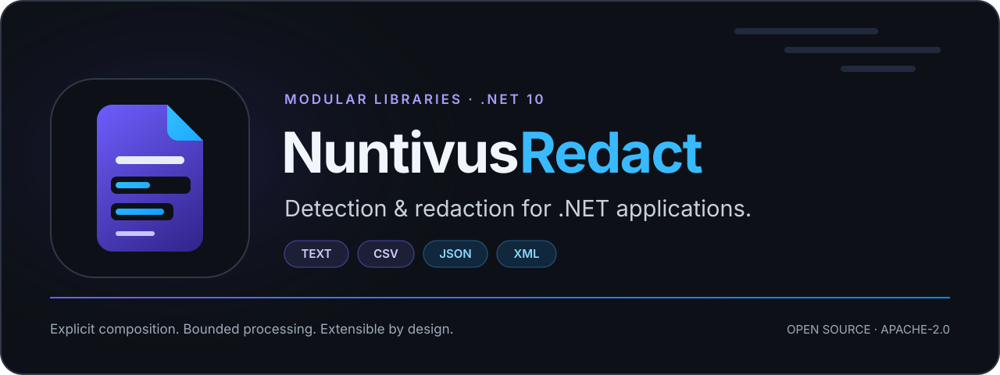

<p align="center">
  
</p>

<h1 align="center">NuntivusRedact</h1>

<p align="center"><strong>Composable detection and redaction for .NET applications.</strong><br />Explicit policies. Bounded document processing. Optional DI and ASP.NET Core integration.</p>

<p align="center">
  <a href="https://github.com/nuntivus/nuntivus-redact-dotnet/actions/workflows/ci.yml"></a>
  <a href="https://github.com/nuntivus/nuntivus-redact-dotnet/actions/workflows/release.yml"></a>
  <a href="https://github.com/nuntivus/nuntivus-redact-dotnet/actions/workflows/security.yml"></a>
</p>
<p align="center">
  <a href="global.json"></a>
  <a href="LICENSE"></a>
  <a href="docs/PROJECT_PLAN.md"></a>
  <a href="docs/GETTING_STARTED.md"></a>
</p>
<p align="center">
  <a href="https://github.com/OWNER/REPOSITORY/commits"></a>
  <a href="https://github.com/OWNER/REPOSITORY/issues"></a>
  <a href="https://github.com/OWNER/REPOSITORY/stargazers"></a>
</p>

<p align="center"><a href="docs/GETTING_STARTED.md">Get started</a> · <a href="docs/README.md">Documentation</a> · <a href="docs/formats/structured.md">Supported formats</a> · <a href="CONTRIBUTING.md">Contribute</a> · <a href="docs/PROJECT_PLAN.md">Roadmap</a></p>

> **GitHub setup:** `OWNER/REPOSITORY` is an intentional placeholder. Replace it with this library's real repository identity before launch; remote badges will not work until configured. See the [GitHub setup checklist](docs/GITHUB_SETUP.md). Package preparation is not a deployment or public release.
>
> **Alpha / security boundary:** NuntivusRedact is not a complete document-sanitization product. Successful replacement means configured matches were transformed—not that every sensitive value was found. Office, PDF, images and OCR are unsupported. No NuGet package is currently published.

## Why NuntivusRedact?

NuntivusRedact is a modular **.NET 10** library for applications that need to detect candidate sensitive values and apply explicit redaction policies. It is intended for use in the parent Nuntivus application and other .NET projects, without requiring the parent application's infrastructure.

- **Explicit composition:** choose detectors, strategies and format processors. No reflection-based plugin discovery, mandatory DI container or unknown-format fallback.
- **Deterministic policies:** immutable policy snapshots, confidence/category filters, priorities and overlap resolution before transformation.
- **Extensible detection:** email, phone, IP, IBAN, URL and credit-card candidates, plus bounded regex, keywords/dictionaries and custom detectors. Heuristics have [documented limitations](docs/DETECTION.md).
- **Selectable transformation:** fixed/category replacement, full/partial masking and keyed HMAC pseudonymization. These have different semantics; none proves anonymization.
- **Bounded structured processing:** UTF-8 TXT/CSV/JSON/XML, cancellation, numeric source-free reports and output staging/revalidation before commit.
- **Optional integrations:** Microsoft DI registration and a raw-body ASP.NET Core adapter, while Core stays independent of both.
- **Established format libraries:** CsvHelper for CSV, System.Text.Json for JSON, System.Xml/LINQ to XML for XML, and .NET encoding/streams for text.

## Quick start

Install SDK **10.0.401** (or an allowed 10.0.4xx patch; see [global.json](global.json)), open a terminal in the source checkout, and run:

```sh
dotnet restore NuntivusRedact.slnx
dotnet build NuntivusRedact.slnx -c Release --no-restore
dotnet test NuntivusRedact.slnx -c Release --no-build
dotnet run --project samples/NuntivusRedact.Sample.Console -c Release
```

The console sample processes synthetic JSON and asserts the result without logging the document. Always name the solution: multiple solution/project entry points coexist, so do not use bare `dotnet build` at the root. Visual Studio users can open [NuntivusRedact.slnx](NuntivusRedact.slnx) or [NuntivusRedact.Workspace.slnx](NuntivusRedact.Workspace.slnx).

For standalone text processing, reference the Core, Detectors.PersonalData and Strategies packages/projects:

```csharp
using NuntivusRedact;
using NuntivusRedact.Core;
using NuntivusRedact.Detectors.PersonalData;
using NuntivusRedact.Strategies;

var policy = new RedactionPolicyBuilder(new FixedReplacementStrategy()).Build();
var engine = new RedactionEngine(
    [new DetectorRegistration(PersonalDataDetectors.Email())], policy);

var result = await engine.RedactAsync("Contact alice@example.com.");
if (result.Text != "Contact [REDACTED].")
    throw new InvalidOperationException("Synthetic example verification failed.");
Console.WriteLine($"Replacements: {result.Detections.Count}.");
```

See [Getting started](docs/GETTING_STARTED.md) for local NuGet feeds, structured document processing, cancellation and stream ownership. These are **unreleased `0.1.0-alpha.1` candidates**: build locally rather than assuming a public-feed install is available.

## Supported formats

| Format | Implemented profile | Important boundaries |
| --- | --- | --- |
| TXT | Explicit UTF-8 plain text, optional UTF-8 BOM | Not a fallback for unknown/binary formats |
| CSV | Comma-separated, doubled quotes, quoted multiline cells, headers treated as data | No dialect guessing or spreadsheet-formula sanitization; ragged/blank rows preserved |
| JSON | Decoded string keys/values with primitive types preserved | Duplicate/colliding keys and detections in non-string primitives fail closed |
| XML | Leaf text/CDATA, ordinary attributes and comments | DTDs, processing instructions, mixed content and detected structural identifiers are rejected |
| Office / PDF / images / OCR | **Unsupported** | Planned work is not a support claim |

Defaults are 4 MB input, 8 MB output, depth 64, 10,000 inspected fields/nodes and 10,000 accepted detections; individual text-engine limits also apply. Processing buffers bounded data in memory—it is not constant-memory streaming. Invalid UTF-8, malformed input, unsupported features and exceeded limits fail closed. Read the [complete format/security profile](docs/formats/structured.md) before integrating.

Input/output streams remain caller-owned; destinations must start empty. **Discard output after any error**, including a failed output write. Original formatting, schemas, signatures, source-file deletion and managed-memory erasure are not guaranteed.

## Packages and architecture

Eleven independent product packages can be built locally. Install only the modules needed by the application; there is no all-in-one published package.

| Package | Responsibility |
| --- | --- |
| [NuntivusRedact.Abstractions](src/NuntivusRedact.Abstractions) | Immutable detection, strategy and document contracts |
| [NuntivusRedact.Core](src/NuntivusRedact.Core) | Deterministic engine, policies and overlap resolution |
| [NuntivusRedact.Detectors.Regex](src/NuntivusRedact.Detectors.Regex) | Bounded custom regex and dictionary/keyword detection |
| [NuntivusRedact.Detectors.PersonalData](src/NuntivusRedact.Detectors.PersonalData) | Personal-data candidate detectors |
| [NuntivusRedact.Strategies](src/NuntivusRedact.Strategies) | Replacement, masking and keyed pseudonymization |
| [NuntivusRedact.Formats.Text](src/NuntivusRedact.Formats.Text) | UTF-8 text and bounded staging/reporting infrastructure |
| [NuntivusRedact.Formats.Csv](src/NuntivusRedact.Formats.Csv) | Strict CSV with CsvHelper |
| [NuntivusRedact.Formats.Json](src/NuntivusRedact.Formats.Json) | System.Text.Json-based processing |
| [NuntivusRedact.Formats.Xml](src/NuntivusRedact.Formats.Xml) | Hardened System.Xml/LINQ to XML processing |
| [NuntivusRedact.Extensions.DependencyInjection](src/NuntivusRedact.Extensions.DependencyInjection) | Optional explicit DI registration |
| [NuntivusRedact.AspNetCore](src/NuntivusRedact.AspNetCore) | Optional bounded raw-body HTTP adapter |

Dependencies point inward: Abstractions has no product dependencies, Core depends on Abstractions, and adapters compose outside the engine. Branded entry points include `AddNuntivusRedact`, `AddNuntivusRedactHttp` and `MapNuntivusRedact`. See [Architecture](docs/ARCHITECTURE.md), [extension contracts](docs/EXTENSIBILITY.md) and the [alpha migration notes](docs/MIGRATION.md).

## Samples and HTTP integration

| Example | Run from the repository root |
| --- | --- |
| Standalone JSON | `dotnet run --project samples/NuntivusRedact.Sample.Console -c Release` |
| Optional DI | `dotnet run --project samples/NuntivusRedact.Sample.DependencyInjection -c Release` |
| Custom detector | `dotnet run --project samples/NuntivusRedact.Sample.CustomDetector -c Release` |
| Local API | `dotnet run --project samples/NuntivusRedact.Sample.WebApi --urls http://127.0.0.1:5187` |

The API sample exposes `/openapi/v1.json` and raw-body `/redact/text`, `/redact/csv`, `/redact/json`, `/redact/xml` endpoints. It is **not a production service**. Hosts own authentication, authorization, TLS, logging policy, rate/concurrency limits and deployment isolation. See the [HTTP guide](docs/HTTP.md); use synthetic data and stop the local host after testing.

## Build, test and package checks

With PowerShell 7 and the pinned SDK:

```powershell
pwsh -File ./tools/verification/verify.ps1
pwsh -File ./tools/verification/verify.ps1 -Task format-check
pwsh -File ./tools/verification/docs-check.ps1
pwsh -File ./tools/verification/package-smoke.ps1
```

The verification script restores, builds Release, runs xUnit tests and creates `.nupkg`/`.snupkg` candidates under `artifacts/packages`. Package smoke inspects all eleven package/symbol pairs and runs an isolated consumer. The intentionally nonpackable Web API sample can emit a pack warning. POSIX users can run `sh tools/verification/verify.sh`; the package/documentation scripts use PowerShell 7.

CI is configured for Windows/Linux. The manual [package-preparation workflow](.github/workflows/release.yml) uploads candidate artifacts only; **no publishing or deployment occurs**. Workflow badges reflect hosted runs only after repository setup. Local executed results, known blockers and historical evidence are in [Progress](docs/PROGRESS.md).

## Documentation

- [Documentation index](docs/README.md) and [Getting started](docs/GETTING_STARTED.md)
- [Public API reference](docs/API_REFERENCE.md) and [custom extensions / DI](docs/EXTENSIBILITY.md)
- [Detector behavior](docs/DETECTION.md), [format limits](docs/formats/structured.md) and [HTTP integration](docs/HTTP.md)
- [Security model](docs/SECURITY.md), [reporting policy](SECURITY.md) and [test matrix](docs/TEST_MATRIX.md)
- [Architecture](docs/ARCHITECTURE.md), [decisions](docs/DECISIONS.md) and [historical performance evidence](docs/PERFORMANCE.md)
- [GitHub setup / badges](docs/GITHUB_SETUP.md), [artwork](docs/assets/README.md) and [release checklist](docs/RELEASE_PLAN.md)

## Roadmap and maturity

The managed-text profile is implemented and locally tested, but the **full roadmap is incomplete**. Office/PDF/OCR, binary recovery/native isolation, remaining extension contracts, binary performance and final release gates remain unfinished. Repository/Source Link provenance also needs the actual approved Git identity.

[Historical managed benchmarks](docs/PERFORMANCE.md) are environment-specific measurements, not general throughput or current-version guarantees. They predate the CSV backend change; no new timings are claimed. A badge, sample HTTP response or detector match is not a security certification or proof of anonymization.

Follow the [project plan](docs/PROJECT_PLAN.md), [detailed tasks](docs/TASKS.md), [progress evidence](docs/PROGRESS.md) and [resume record](docs/RESUME.md). Actual files and executed results are authoritative.

## Contributing and support

Contributions and synthetic bug reproductions are welcome. Read [Contributing](CONTRIBUTING.md), the [Code of conduct](CODE_OF_CONDUCT.md) and [agent/repository rules](AGENTS.md). Keep dependencies inward, document public contracts and add positive, negative, cancellation and security checks with implementation changes.

For ordinary defects, use the repository's bug report template after GitHub setup. **Do not post real documents, personal data, keys or private vulnerability details in public issues.** Follow [SECURITY.md](SECURITY.md) for private reporting; the owner must establish and monitor that channel. No production support commitment or response SLA is currently offered. Never publish packages without explicit owner approval.

## License

Code and the original SVG artwork are licensed under [Apache-2.0](LICENSE). Third-party dependencies retain their own licenses; CsvHelper's Apache-2.0 option is documented in [ADR-009](docs/DECISIONS.md). No trademark registration or parent-project endorsement is asserted.
